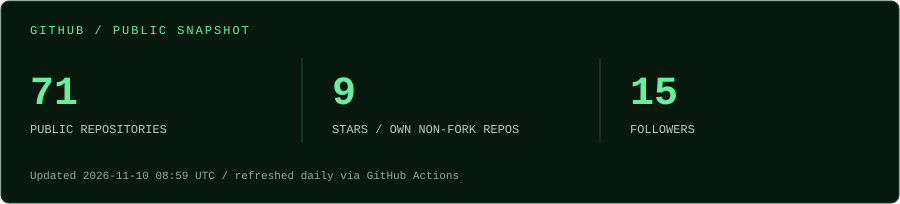

<p align="center">
  
</p>

Hi, I'm **Fernando**. I build backend systems with Java and Spring, with experience across scientific software, healthcare, and enterprise applications.

**Java** · **Spring Boot** · **AWS** · **Docker** · **MongoDB** · **Jenkins**

[LinkedIn ↗](https://www.linkedin.com/in/oalmeidajavadeveloper/) · [X / Twitter ↗](https://x.com/faflpx) · [Explore my repositories ↗](https://github.com/almeidaah?tab=repositories)

## $ cat career.log

```text
2025 - now   Elsevier       Senior Software Engineer · Remote
2020 - 2025  SciBite        Software Developer · Remote
2018 - 2020  Aubay France   Full Stack Developer · SciBite assignment
2017 - 2018  Suntech        Full Stack Developer · Verint group
2013 - 2017  Portal Unimed  Full Stack Software Developer
2011 - 2013  Softplan       Software Developer
```

## $ ls featured-projects/

| Repository | What you'll find |
| :--- | :--- |
| [my-own-cv-api](https://github.com/almeidaah/my-own-cv-api) | A CV served as a public API, built with Spring Boot, MongoDB, and Swagger UI. |
| [world-visited-app-a6](https://github.com/almeidaah/world-visited-app-a6) | A travel-inspired application built with Angular and TypeScript. |
| [openproject_scrum_monitoring_plugin](https://github.com/almeidaah/openproject_scrum_monitoring_plugin) | Scrum monitoring plugin for OpenProject. |

## $ git stats

<p align="center">
  <a href="https://github.com/almeidaah">
    
  </a>
</p>

*Activity card by [dvigo/github-stats](https://github.com/dvigo/github-stats). Commits cover the last year; PRs and issues are labeled all-time. Language percentages describe the provider's repository sample, not necessarily my professional work. Complete private/organization coverage is not verified. Provider availability and GitHub image caching affect updates.*

### Public account snapshot

<p>
  
</p>

*Account snapshot refreshed daily and on manual workflow runs, not in real time. Repository count includes public forks; stars count only owned, non-fork public repositories. This snapshot does not measure employer-owned or private contributions. Neither stats image lists repository names.*

---

**BSc Information Systems**, UFSC · **MBA Software Architecture**, IGTI  
Off the keyboard: exploring new places.
